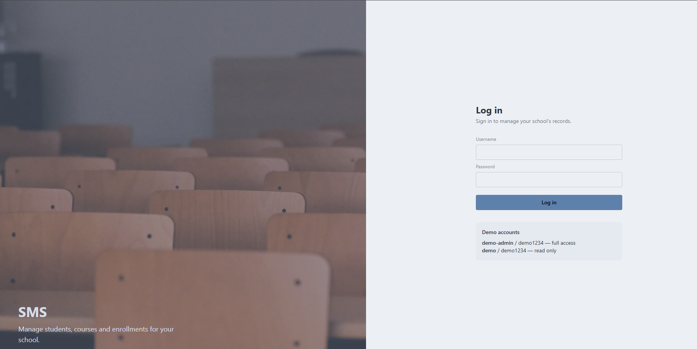
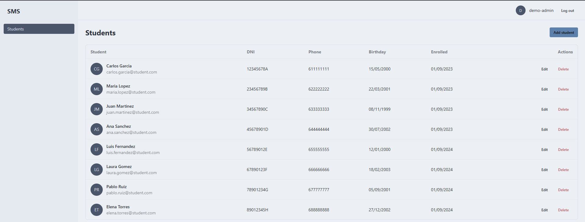
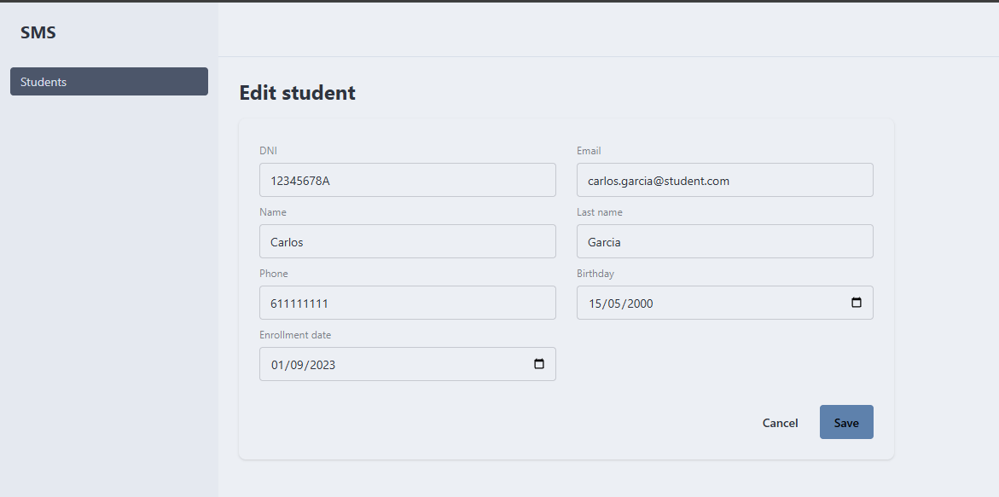

# Student Management System — Frontend

Angular frontend for the [Student Management System API](https://github.com/LJunLL/sms-api): a tool for managing students, courses and enrollments in an educational institution.

**Live demo:** [ljunll-sms.netlify.app](https://ljunll-sms.netlify.app) · **Backend repo:** [sms-api](https://github.com/LJunLL/sms-api)

> The backend runs on a free hosting plan that sleeps after 15 minutes of inactivity. The first login after that can take up to a minute while the server wakes up.

## Demo Accounts

| Username   | Password | Role  | Access                                       |
| ---------- | -------- | ----- | -------------------------------------------- |
| demo-admin | demo1234 | ADMIN | Full access: create, edit and delete records |
| demo       | demo1234 | USER  | Read only                                    |

## Screenshots





## Features

- **JWT authentication**: login against the API, token stored in the browser and attached automatically to every API request through an HTTP interceptor.
- **Session handling**: expired or invalid tokens are detected and the user is redirected to the login page with an explanatory message.
- **Route protection** with functional guards: authenticated routes, guest-only login page and admin-only pages.
- **Role-based UI**: create, edit and delete actions are only shown to administrators.
- **Students management**: full CRUD with reactive forms, client-side validation matching the API rules, and error messages from the backend.
- **Loading, error and empty states** for data fetched with `rxResource`.
- **Responsive layout** with a sidebar that turns into a drawer menu on mobile.

## Tech Stack

- Angular 21 (standalone components, signals, `rxResource`, functional guards and interceptors)
- TypeScript
- RxJS
- Tailwind CSS 4
- daisyUI 5

## Project Structure

```
src/app/
├── auth/          # Login page, AuthService, guards and JWT interceptor
├── shared/        # Navbar and sidebar
└── sms/           # Main layout and the management pages (students...)
```

## Getting Started

### Prerequisites

- Node.js 22+
- The [backend API](https://github.com/LJunLL/sms-api) running on `http://localhost:8080`

### Run locally

```bash
git clone https://github.com/LJunLL/sms-frontend.git
cd sms-frontend
npm install
ng serve
```

Open http://localhost:4200. With the backend in development mode, you can log in with `admin` / `admin123` or `user` / `password123`.

### Environments

The API URL is configured per environment:

- `src/environments/environment.development.ts`: used by `ng serve`
- `src/environments/environment.ts`: used by `ng build` (production)

## Deployment

The app is deployed on Netlify, which rebuilds it on every push to `main`:

- **Build command:** `npm run build`
- **Publish directory:** `dist/sms-frontend/browser`

The `public/_redirects` file sends every route to `index.html`, so Angular routes such as `/students` keep working when the page is reloaded.

## License

This project is licensed under the MIT License. See the [LICENSE](LICENSE) file for details.
